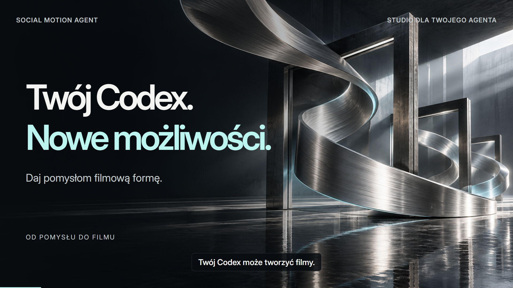

[](https://github.com/aievolutionpl/social-motion-agent/raw/refs/heads/main/docs/media/premium-intro.mp4)

# Social Motion Agent

**Od briefu do dopracowanego filmu, strony lub animacji produktu.**

Warsztat [AI EVOLUTION POLSKA](https://www.aievolutionpolska.pl/) dla agentów, którzy potrafią czytać pliki, pisać kod i uruchamiać narzędzia. Jeden nadrzędny skill dobiera specjalistyczne instrukcje, pomaga ustalić kierunek wizualny i prowadzi do sprawdzonego rezultatu.

[](https://github.com/aievolutionpl/social-motion-agent/actions/workflows/ci.yml) · [English](docs/README.en.md) · [Skill](skills/creative-director/SKILL.md) · [Konfiguracja agentów](docs/AGENT_SETUP.md) · [MIT — kod](LICENSE)

## Daj zadanie agentowi

Otwórz repo w Codexie, Claude Code, Hermesie lub innym agencie z plikami i terminalem:

> Przeczytaj AGENTS.md, START_HERE.md i skills/creative-director/SKILL.md. Chcę 20-sekundowy film mojego produktu w pionie. Wykorzystaj informacje, które już podałem, i zapytaj o brakujące decyzje. Pokaż dwa konkretne kierunki wizualne. Przygotuj potrzebne skille, storyboard i draft, potem sprawdź obraz, dźwięk i napisy. Nie publikuj ani nie uruchamiaj płatnych generacji bez zgody.

Dla strony podaj ofertę, odbiorcę i główną akcję. Dla animacji UI wskaż interfejs oraz to, czy ma działać na stronie, czy trafić do MP4. Samo połączenie GitHub udostępnia źródła; wykonanie projektu wymaga środowiska pracy z odpowiednimi narzędziami.

## Jeden skill, trzy ścieżki

| Zadanie | Proces | Wynik |
| --- | --- | --- |
| **Film**: Reels, Shorts, premiera, explainer, tutorial | Brief → kierunek → storyboard → kompozycja → render → recenzja | MP4, źródła, materiały i dowody kontroli |
| **Strona**: landing page, produkt, poprawa istniejącego projektu | Oferta → układ → typografia i obrazy → implementacja → przegląd w przeglądarce | Działający projekt w jego obecnym stacku |
| **UI motion**: pokaz produktu, animowana makieta, sekcja strony | Zgodność statyczna → akcja i rezultat → ruch → kontrola formatu | Animacja na stronie albo film zgodnie z briefem |

`creative-director` ma **10 modułów referencyjnych**: brief i kierunek, reżyserię wideo, web design, animację UI, receptury wizualne, **anti-slop**, **humanizer PL/EN**, dobór narzędzi, recenzję oraz źródła. Agent czyta tylko potrzebne moduły.

- **Kierunek przed kodem:** dwie lub trzy propozycje pokazują konkretny obraz, typografię, rytm i miejsce użycia; w razie potrzeby styleboard lub reprezentatywną scenę.
- **Pytania bez powtarzania:** znane odpowiedzi trafiają do briefu; pytania dotyczą brakujących decyzji. Drobna poprawka nie zaczyna produkcji od nowa.
- **Ruch z sensem:** akcja → zmiana stanu → czytelny rezultat. Osobne zasady dla strony i filmu.
- **Ludzki język:** konkrety, prawdziwe dowody i zachowany głos marki.
- **Retencja:** hook, dowód, payoff i warianty do porównania. Skill nie obiecuje wiralowości ani nie fabrykuje wyników.

## Sprawdzone źródła, przypięte wersje

| Źródło | Wkład |
| --- | --- |
| [Elaya AI Design Skills](https://github.com/elayadesign/ai-design-skills) | Strategia landing page, zgodność statycznego UI i znaczący motion |
| [Taste Skill v2](https://github.com/Leonxlnx/taste-skill) | Art direction, typografia, kompozycja i ocena screenshotów |
| [Hypermotion](https://github.com/psiddharthdesign/hypermotion) | Profil marki, reżyseria explainera, edytowalne sceny `.hype` |
| [Unslop](https://github.com/heydamir/unslop) | 4-etapowy audyt redline (`Spacing`, `Color & icons`, `Type & copy`, `Details`), tinted neutral ramps, efekty Canvas i sceny Before→After (`unslop-story`) |
| [Opus 5.5 Video Styles](https://github.com/HiAPIAI/awesome-opus-5-5-video-styles) + [Opus 5.5 Videos](https://github.com/yihui-dev/awesome-opus5-5-videos) | 12 kanonicznych stylów wideo, 1128 promptów referencyjnych, fizyka sprężyn (`stepSpring`, `liquidSpan`) i kontrakt podagenta `<inputs>/<direction>/<structure>/<build>/<gotchas>` |
| Dotychczasowa biblioteka motion | Kinetic type, audio, mapy, wykresy, 3D, tutoriale i montaż |

Wersje i licencje: [sources.lock.json](sources.lock.json). Oryginalne licencje zostają zachowane. Brief, istniejąca marka i dostępność mają pierwszeństwo przed stylistycznymi domyślnościami upstream — bez obowiązkowych zakazów kolorów i liczby animacji.

## Przygotuj potrzebne skille

Do pobrania źródeł wystarczą Python 3.11+ i Git. Nie uruchamia to kodu upstream ani płatnych usług.

```bash
git clone https://github.com/aievolutionpl/social-motion-agent.git
cd social-motion-agent
python -S studio.py skills plan --mode video
python -S studio.py skills setup --mode video
python -S studio.py skills check --mode video
```

Tryby: `video`, `website`, `ui-motion`. Film przygotowuje Hypermotion i Elaya; strona — Elaya i Taste; UI motion — wszystkie trzy źródła. `check` działa offline i sprawdza źródła, **nie potwierdza działania rendererów ani kont**.

Cała biblioteka obejmuje **38 przypiętych repozytoriów**. Użyj `studio.py find`, `studio.py route`, `studio.py styles`, `studio.py unslop-story` i `studio.py motion`, aby dobrać specjalistę lub styl wideo. Pełne pobranie jest opcjonalne:

```bash
python -S scripts/bootstrap_library.py
python -S scripts/library_check.py
```

[Indeks skilli](skills/INDEX.md) · [Biblioteka](docs/LIBRARY.md) · [Wersje źródeł](docs/SOURCE_VERSIONS.md)

## Zainstaluj przenośny skill

Instalator kopiuje cały skill wraz z referencjami. Domyślnie pokazuje plan, zachowuje istniejące instalacje i nie łączy kont.

```bash
python -S scripts/install_skill.py --agent codex
python -S scripts/install_skill.py --agent codex --execute

# Wybierz środowisko, którego używasz
python -S scripts/install_skill.py --agent claude --execute
python -S scripts/install_skill.py --agent hermes --execute
```

Własny katalog skilli: `--dest`. Do filmów zainstalowany skill prowadzi do roboczej kopii Social Motion Agent; strony mogą korzystać z jego wskazówek bez renderera wideo. [Ścieżki profili i kompatybilność](docs/AGENT_SETUP.md).

## Wyrenderuj pierwszy film

Wymagania: **Python 3.11+, Node.js 22+, FFmpeg i ffprobe**. Pythonowy rdzeń nie wymaga pakietów pip.

```bash
python -S studio.py setup
python -S studio.py demo --format 9:16 --render

# Intro z polskim lektorem i dostarczoną muzyką
python -S scripts/premium_intro.py --render
```

`setup` instaluje przypięte zależności przez `npm ci --ignore-scripts`. Pierwszy render może pobrać Chromium. Przykłady korzystają z dołączonych materiałów, bez płatnej generacji.

**HyperFrames** renderuje lokalne HTML/GSAP. **Hypermotion** jest osobną aplikacją z projektami `.hype`, CLI i MCP. Agent pobiera jego skille, a przed natywnym eksportem sprawdza runtime i krótki render. Nie zamienia po cichu silnika wskazanego przez użytkownika. [Hypermotion — konfiguracja](docs/HYPERMOTION.md).


[Intro 30 s ze źródłami](examples/premium-intro/README.md) · [Showcase 36 s](examples/showcase/README.md) · [HyperFrames](docs/HYPERFRAMES.md)

## Jakość jako część procesu

Każdy film ma osobny katalog `output/jobs/<id>/`. Render jest powiązany z SHA pliku i stanem źródeł z chwili renderowania. Nowa kompozycja wymaga nowego renderu; ponowny `probe` nie zatwierdzi starych klatek jako nowego projektu. Kontrola długości obrazu zapobiega maskowaniu brakujących klatek przez audio.

`pack` wymaga kontroli i recenzji. Sprawdza zapisane dowody, ale nie zastępuje oglądania i odsłuchu. Dla stron agent sprawdza układ, klawiaturę, responsive, reduced motion i stany błędu. Bez narzędzia nie deklaruje wykonania testu.

```bash
python -S -B -m unittest discover -s tests -v
python -S scripts/smoke_test.py
python -S scripts/release_check.py
```

CI obejmuje Linux/Python 3.11 i 3.13, Windows, FFmpeg, rzeczywisty render HyperFrames oraz testy przeglądarkowe. [Produkcja](docs/PRODUCTION.md) · [CLI](docs/CLI.md) · [Weryfikacja](docs/VALIDATION.md)

## Materiały i wydania

126 efektów dźwiękowych, 9 teł, fonty z licencjami OFL i źródła pokazówek. Prawa do mediów są oddzielne od licencji kodu; dokumenty źródłowe licencji biblioteki SFX pozostają do uzupełnienia. [Prawa do mediów](docs/MEDIA_RIGHTS.md) · [Third-party notices](THIRD_PARTY_NOTICES.md).

Sekrety pochodzą z własnego środowiska, produkcje są ignorowane przez Git. Rdzeń nie publikuje filmów; generacje i publikacja wymagają właściwej autoryzacji. [Providerzy](docs/PROVIDERS.md) · [Bezpieczeństwo](SECURITY.md).

[Pełny ZIP v1.1.1](https://github.com/aievolutionpl/social-motion-agent/releases/download/v1.1.1/social-motion-agent-v1.1.1-full.zip) to archiwalne wydanie z 34 źródłami. **Nie zawiera Creative Director ani obecnych poprawek** — użyj aktualnego checkoutu. Nowy pełny ZIP wymaga osobnego zbudowania i publikacji.

Projekt niezależny od autorów użytych narzędzi; nie sugeruje ich poparcia. [Współtworzenie](CONTRIBUTING.md).
