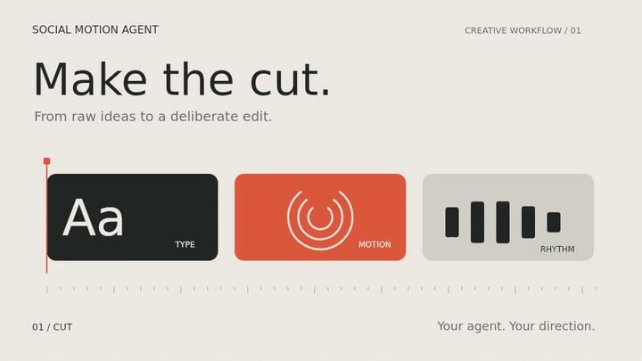
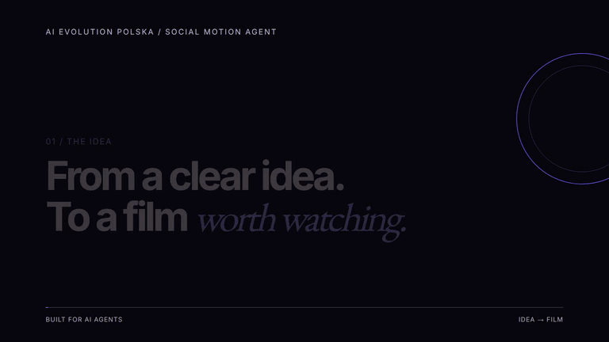

# Social Motion Agent

[](docs/media/editorial-loop.mp4)

**[Obejrzyj demo · 8 s · bez dźwięku](docs/media/editorial-loop.mp4)** · [Źródła i odtworzenie](examples/editorial-loop/README.md)

Wybierz kierunek. Zobacz podgląd. Powiedz, co poprawić. Agent prowadzi kolejną wersję.

[Start](#szybki-start-z-agentem) · [Style](#nowe-style-motion) · [Instalacja](#wyrenderuj-pierwszy-film) · [Jakość](#jakość-jako-część-procesu)

**[🌐 Zobacz stronę Social Motion Agent](https://social-motion-agent-aiep.pages.dev/)**

**Od briefu do dopracowanego filmu, strony lub animacji produktu.**

Warsztat [AI EVOLUTION POLSKA](https://www.aievolutionpolska.pl/) dla agentów, którzy potrafią czytać pliki, pisać kod i uruchamiać narzędzia. Jeden nadrzędny skill prowadzi brief, kierunek, kompozycję i recenzję. **Kinetic Film** tworzy premiery produktów i teasery do rytmu muzyki; **HyperFrames** renderuje HTML/GSAP, a natywny **Hypermotion** ma osobny adapter. Style Atlas i Unslop pomagają dobrać wygląd oraz sprawdzić rezultat.

[](https://github.com/aievolutionpl/social-motion-agent/actions/workflows/ci.yml) · [English](docs/README.en.md) · [Skill](skills/creative-director/SKILL.md) · [Konfiguracja agentów](docs/AGENT_SETUP.md) · [MIT — kod](LICENSE)

## Szybki start z agentem

Otwórz repo w agencie z terminalem i wklej:

> Przeczytaj AGENTS.md i START_HERE.md. Przygotuj lokalne zależności przez scripts/quickstart.py --browser, sprawdź brakujące narzędzia i uruchom testowy render. Chcę krótki film o [temat]. Najpierw zapytaj o styl i brakujące elementy briefu. Pokaż 2–3 konkretne kierunki, poleć jeden i poczekaj na mój wybór. Po podglądzie zapytaj, co zostawić, co zmienić i jak oceniam styl, tempo oraz czytelność. Zaproponuj konkretne ulepszenia następnej wersji.

```bash
python -S scripts/quickstart.py --browser --smoke
```

Komenda ponownie wykorzystuje zgodne zależności, instaluje brakujące przez zablokowane wersje npm, pobiera Chromium i uruchamia demo. Wymaga Python 3.11+, Node 22+, npm oraz FFmpeg/ffprobe. Braki systemowe zgłasza agentowi; opcjonalne silniki i konta usług mają osobną konfigurację. Sam dostęp do GitHub nie uruchamia instalacji.

| Etap | Co dostajesz |
| --- | --- |
| Kierunek | Pytanie o styl, 2–3 propozycje, rekomendacja i reprezentatywny kadr |
| Podgląd | Film oraz krótka ocena mocnych i słabych momentów |
| Feedback | Co zachować, co zmienić, opcjonalne oceny 1–5 |
| Poprawka | Nowa wersja, lista zmian i 2–3 pomysły dalszego rozwoju |

[Zasady wyboru stylu i feedbacku](skills/creative-director/references/feedback-loop.md). GIF jest syntetyczną ilustracją procesu, nie nagraniem działającego edytora.

<details>
<summary><strong>Katalog możliwości i ścieżek produkcji</strong></summary>

## Nowe style motion

**Kinetic Walk & Talk** dodaje rolki z chodzącym prezenterem, małymi podpisami i dużymi
animowanymi hasłami, także za sylwetką. Trasa `kinetic-walk-talk` obejmuje plan nagrania,
prompty do czystych ujęć AI, kompozycję warstw i plan dźwięku. Lokalne `walk-talk prepare`
i `walk-talk compose` tworzą edytowalne źródła HyperFrames z dostarczonych mediów;
generowanie ujęć i segmentacja korzystają z osobno dostępnych narzędzi.
[Skill](skills/kinetic-walk-talk/SKILL.md) · [Instrukcja i przykład JSON](docs/KINETIC_WALK_TALK.md).

**Motion, nie slajdy** — 13 deterministycznych stylów Canvas z `seek(t)` w laboratorium [examples/motion-styles](examples/motion-styles/README.md): Riso Print, Décollage, Optical Moiré oraz 10 nowych kierunków: **Grainy Gradient**, **Poster Color-Block**, **Flat Pop z wycinkami zdjęć**, **Visual Journalism**, **Vintage Sketch**, **Cartoon Collage**, **White Catalog**, **Brutalist Mono**, **Luxury Dark** i **Continuous Action**. Do tego:

- `python -S studio.py directions brief --for "aplikacja AI dla studentów"` — szkielet style briefu, 3 kandydackie koncepty z menu 19 konceptów openerów i 3 kierunki stylu z 10;
- `python -S studio.py directions compare "FP1" "FP2"` — czy nowy film różni się strukturą od poprzedniego (odcisk: koncept · sceny · obiekty · otwarcie · zakończenie);
- `python -S studio.py motion lint scena.html` — mechaniczny test „to film, nie prezentacja” i kontraktu renderu (losowość, zegar, `window.seek`, sekcje przełączane opacity, kicker+tytuł+body, autoplay wideo, przejścia CSS);
- moduł [Motion, not slides](skills/creative-director/references/motion-not-slides.md) oraz helpery kamery ujęć, żywego ziarna i asymetrycznego rytmu w `templates/motion-helpers.js`.

Idee zaadaptowane z [bangtutorial/bang-motion](https://github.com/bangtutorial/bang-motion) (MIT), tekst i kod napisane od nowa. Presety to przykłady, nie gotowe kompozycje HyperFrames.

## Director Suite: 3 nowe ścieżki produkcji

Z [Explainroo](https://github.com/vincentsch/explainroo), [Argo](https://github.com/shreyaskarnik/argo) i [Huashu Motion](https://github.com/alchaincyf/huashu-motion) zaadaptowaliśmy praktyczne wzorce, bez kopiowania obcych silników do repo:

- **Explainer:** szkic Explainroo, lokalne napisy SRT i zdarzenia zsynchronizowane z **rzeczywistymi** czasami słów z alignera. Polski lektor wymaga nagrania lub zewnętrznego TTS.
- **Product demo:** szkic Playwright + Argo (manifest scen, markery narracji, overlay), do uzupełnienia prawdziwymi akcjami i uruchomienia w środowisku testowym.
- **Motion launch:** beat sheet, kontrola rytmu scen i komentarze do konkretnej sekundy oraz współrzędnych kadru. Handoff do Huashu Motion nie udaje gotowego projektu `om`.

```bash
# Po utworzeniu joba i zapisaniu jego storyboard.json
python -S studio.py director plan output/jobs/ID --profile launch
python -S studio.py director qa output/jobs/ID --profile launch
python -S studio.py director handoff output/jobs/ID --profile demo
python -S studio.py director captions output/jobs/ID --alignment source/alignment.json
python -S studio.py director feedback output/jobs/ID --at 4.2 --x 0.6 --y 0.3 --comment "Powiększ CTA"
```

Komendy przygotowują edytowalne źródła i kontrolę planu, **nie instalują generatorów wideo, nie renderują i nie zatwierdzają automatycznie jakości**. Dla eksportów używaj `--overwrite` tylko gdy chcesz zastąpić pliki z własnymi poprawkami.

[Pełna instrukcja i ograniczenia](docs/DIRECTOR_SUITE.md) · [Skill](skills/director-suite/SKILL.md).

</details>

## Daj zadanie agentowi

> Przeczytaj AGENTS.md i skills/kinetic-launch/SKILL.md. Chcę 30-sekundowy teaser w stylu Kinetic Film. Użyj trasy kinetic-launch, zachowaj mój brief i przygotuj sceny na siatce beatów. Wyrenderuj podgląd, sprawdź ruch, obraz i dźwięk. Bez publikacji ani płatnych generacji bez zgody.

[Poprzedni film Kinetic](docs/media/kinetic-launch.mp4) pokazuje workflow od briefu do kontroli: duża typografia, kamera CSS 3D, motion blur i lokalny miks. To animowana ilustracja procesu, nie nagranie wykonania agenta. Odtworzenie używa dostarczonego audio. [Konfiguracja Kinetic Film](docs/KINETIC_FILM.md).

Otwórz repo w Codexie, Claude Code, Hermesie lub innym agencie z plikami i terminalem:

> Przeczytaj AGENTS.md, START_HERE.md i skills/creative-director/SKILL.md. Chcę 20-sekundowy film mojego produktu w pionie. Wykorzystaj informacje, które już podałem, i zapytaj o brakujące decyzje. Pokaż dwa konkretne kierunki wizualne. Przygotuj potrzebne skille, storyboard i draft, potem sprawdź obraz, dźwięk i napisy. Nie publikuj ani nie uruchamiaj płatnych generacji bez zgody.

Dla strony podaj ofertę, odbiorcę i główną akcję. Dla animacji UI wskaż interfejs oraz to, czy ma działać na stronie, czy trafić do MP4. Samo połączenie GitHub udostępnia źródła; wykonanie projektu wymaga środowiska pracy z odpowiednimi narzędziami.

## Jeden skill i dobór ścieżki

| Zadanie | Proces | Wynik |
| --- | --- | --- |
| **Film**: Reels, Shorts, premiera, explainer, tutorial | Brief → kierunek → storyboard → kompozycja → render → recenzja | MP4, źródła, materiały i dowody kontroli |
| **Kinetic Walk & Talk**: pionowa rolka z prezenterem | Ujęcia → czasy słów → podpisy i hasła → sylwetka alpha → miks → render i recenzja | MP4 9:16, edytowalny HTML i plan produkcyjny |
| **Kinetic launch**: teaser i premiera z dużą typografią | Brief → beat sheet → spec.js → motion blur → kontrola ruchu i recenzja | MP4 16:9, edytowalna kompozycja, audio i dowody renderu |
| **Strona**: landing page, produkt, poprawa istniejącego projektu | Oferta → układ → typografia i obrazy → implementacja → przegląd w przeglądarce | Działający projekt w jego obecnym stacku |
| **UI motion**: pokaz produktu, animowana makieta, sekcja strony | Zgodność statyczna → akcja i rezultat → ruch → kontrola formatu | Animacja na stronie albo film zgodnie z briefem |

`creative-director` ma **12 modułów referencyjnych**: brief i kierunek, reżyserię wideo, **motion, nie slajdy**, style explainerów, web design, animację UI, receptury wizualne, **anti-slop**, **humanizer PL/EN**, dobór narzędzi, recenzję oraz źródła. Agent czyta tylko potrzebne moduły.

- **Kierunek przed kodem:** dwie lub trzy propozycje pokazują konkretny obraz, typografię, rytm i miejsce użycia; w razie potrzeby styleboard lub reprezentatywną scenę.
- **Pytania bez powtarzania:** znane odpowiedzi trafiają do briefu; pytania dotyczą brakujących decyzji. Drobna poprawka nie zaczyna produkcji od nowa.
- **Ruch z sensem:** akcja → zmiana stanu → czytelny rezultat. Osobne zasady dla strony i filmu.
- **Ludzki język:** konkrety, prawdziwe dowody i zachowany głos marki.
- **Retencja:** hook, dowód, payoff i warianty do porównania. Skill nie obiecuje wiralowości ani nie fabrykuje wyników.

## Sprawdzone źródła, przypięte wersje

Do explainerów dostępne są też dwa niezależne kierunki: **`isometric-line-art`** — izometryczny rysunek techniczny, montaż, przekroje i przepływy; **`flat-vector`** — ilustracje 2D, morfowanie kształtów i płynne zmiany stanu. Atlas ma teraz 14 stylów (12 źródłowych + 2 lokalne). Użyj `python -S studio.py styles recipe <slug>` i przeczytaj [zasady explainerów](skills/creative-director/references/explainer-styles.md). Dobieraj temat, format i audio w briefie filmu.

| Źródło | Wkład |
| --- | --- |
| [Elaya AI Design Skills](https://github.com/elayadesign/ai-design-skills) | Strategia landing page, zgodność statycznego UI i znaczący motion |
| [Taste Skill v2](https://github.com/Leonxlnx/taste-skill) | Art direction, typografia, kompozycja i ocena screenshotów |
| [Hypermotion](https://github.com/psiddharthdesign/hypermotion) | Profil marki, reżyseria explainera, edytowalne sceny `.hype` |
| [Scenario Kinetic Film](https://www.scenario.com/explorations/kinetic-film/) | Osobny, weryfikowany pakiet silnika: sceny na beat gridzie, kamera CSS 3D i motion blur; trasa `kinetic-launch` |
| [Unslop](https://github.com/heydamir/unslop) | 4-etapowy audyt redline (`Spacing`, `Color & icons`, `Type & copy`, `Details`), tinted neutral ramps, efekty Canvas i sceny Before→After (`unslop-story`) |
| [Opus 5.5 Video Styles](https://github.com/HiAPIAI/awesome-opus-5-5-video-styles) + [Opus 5.5 Videos](https://github.com/yihui-dev/awesome-opus5-5-videos) | 12 kanonicznych stylów wideo, 1128 promptów referencyjnych, fizyka sprężyn (`stepSpring`, `liquidSpan`) i kontrakt podagenta `<inputs>/<direction>/<structure>/<build>/<gotchas>` |
| Dotychczasowa biblioteka motion | Kinetic type, audio, mapy, wykresy, 3D, tutoriale i montaż |

Wersje i licencje: [sources.lock.json](sources.lock.json). Oryginalne licencje zostają zachowane. Brief, istniejąca marka i dostępność mają pierwszeństwo przed stylistycznymi domyślnościami upstream — bez obowiązkowych zakazów kolorów i liczby animacji.

## Przygotuj potrzebne skille

Do pobrania źródeł wystarczą Python 3.11+ i Git. Nie uruchamia to kodu upstream ani płatnych usług.

```bash
git clone https://github.com/aievolutionpl/social-motion-agent.git
cd social-motion-agent
python -S studio.py skills plan --mode video
python -S studio.py skills setup --mode video
python -S studio.py skills check --mode video
```

Tryby: `video`, `website`, `ui-motion`. Film przygotowuje Hypermotion i Elaya; strona — Elaya i Taste; UI motion — wszystkie trzy źródła. `check` działa offline i sprawdza źródła, **nie potwierdza działania rendererów ani kont**.

Cała biblioteka obejmuje **38 przypiętych repozytoriów**. Użyj `studio.py find`, `studio.py route`, `studio.py styles`, `studio.py unslop-story` i `studio.py motion`, aby dobrać specjalistę lub styl wideo. Pełne pobranie jest opcjonalne:

```bash
python -S scripts/bootstrap_library.py
python -S scripts/library_check.py
```

[Indeks skilli](skills/INDEX.md) · [Biblioteka](docs/LIBRARY.md) · [Wersje źródeł](docs/SOURCE_VERSIONS.md)

## Zainstaluj przenośny skill

Instalator kopiuje cały skill wraz z referencjami. Domyślnie pokazuje plan, zachowuje istniejące instalacje i nie łączy kont.

```bash
python -S scripts/install_skill.py --agent codex
python -S scripts/install_skill.py --agent codex --execute

# Wybierz środowisko, którego używasz
python -S scripts/install_skill.py --agent claude --execute
python -S scripts/install_skill.py --agent hermes --execute
```

Własny katalog skilli: `--dest`. Do filmów zainstalowany skill prowadzi do roboczej kopii Social Motion Agent; strony mogą korzystać z jego wskazówek bez renderera wideo. [Ścieżki profili i kompatybilność](docs/AGENT_SETUP.md).

## Wyrenderuj pierwszy film

Wymagania: **Python 3.11+, Node.js 22+, FFmpeg i ffprobe**. Pythonowy rdzeń nie wymaga pakietów pip.

```bash
python -S studio.py setup
python -S studio.py demo --format 9:16 --render

# Kinetic Film: najpierw oficjalny pakiet silnika i opcjonalne zależności
python -S studio.py kinetic setup --source /path/to/scenario-kinetic-film
python -m pip install -r requirements-kinetic.txt
python -S studio.py kinetic doctor
python -S studio.py kinetic demo --render --res 720 --samples 2
```

`setup` instaluje przypięte zależności przez `npm ci --ignore-scripts`. Pierwszy render może pobrać Chromium. Przykłady korzystają z dołączonych materiałów, bez płatnej generacji.

Kinetic Film jest opcjonalnym silnikiem pobieranym osobno od autora. `kinetic setup` sprawdza sumy plików i tworzy lokalny cache, a `render-kinetic` zachowuje karty produkcji, kontrolę dynamiki i dowody zgodności źródeł z MP4. Bieżące kompozycje Kinetic są poziome 16:9; pion wymaga osobnego układu. [Pełny workflow](docs/KINETIC_FILM.md).

**HyperFrames** renderuje lokalne HTML/GSAP. **Hypermotion** jest osobną aplikacją z projektami `.hype`, CLI i MCP. Agent pobiera jego skille, a przed natywnym eksportem sprawdza runtime i krótki render. Nie zamienia po cichu silnika wskazanego przez użytkownika. [Hypermotion — konfiguracja](docs/HYPERMOTION.md).



[Kinetic Film 30 s ze źródłami](examples/kinetic-launch/README.md) · [Showcase 36 s](examples/showcase/README.md) · [HyperFrames](docs/HYPERFRAMES.md)

## Jakość jako część procesu

Każdy film ma osobny katalog `output/jobs/<id>/`. Render jest powiązany z SHA pliku i stanem źródeł z chwili renderowania. Nowa kompozycja wymaga nowego renderu; ponowny `probe` nie zatwierdzi starych klatek jako nowego projektu. Kontrola długości obrazu zapobiega maskowaniu brakujących klatek przez audio.

`pack` wymaga kontroli i recenzji. Sprawdza zapisane dowody, ale nie zastępuje oglądania i odsłuchu. Dla stron agent sprawdza układ, klawiaturę, responsive, reduced motion i stany błędu. Bez narzędzia nie deklaruje wykonania testu.

```bash
python -S -B -m unittest discover -s tests -v
python -S scripts/smoke_test.py
python -S scripts/release_check.py
```

CI obejmuje Linux/Python 3.11 i 3.13, Windows, FFmpeg, rzeczywisty render HyperFrames oraz testy przeglądarkowe. [Produkcja](docs/PRODUCTION.md) · [CLI](docs/CLI.md) · [Weryfikacja](docs/VALIDATION.md)

## Materiały i wydania

126 efektów dźwiękowych, 9 teł, fonty z licencjami OFL i źródła pokazówek. Prawa do mediów są oddzielne od licencji kodu; dokumenty źródłowe licencji biblioteki SFX pozostają do uzupełnienia. [Prawa do mediów](docs/MEDIA_RIGHTS.md) · [Third-party notices](THIRD_PARTY_NOTICES.md).

Sekrety pochodzą z własnego środowiska, produkcje są ignorowane przez Git. Rdzeń nie publikuje filmów; generacje i publikacja wymagają właściwej autoryzacji. [Providerzy](docs/PROVIDERS.md) · [Bezpieczeństwo](SECURITY.md).

[Pełny ZIP v1.1.1](https://github.com/aievolutionpl/social-motion-agent/releases/download/v1.1.1/social-motion-agent-v1.1.1-full.zip) to archiwalne wydanie z 34 źródłami. **Nie zawiera Creative Director ani obecnych poprawek** — użyj aktualnego checkoutu. Nowy pełny ZIP wymaga osobnego zbudowania i publikacji.

Projekt niezależny od autorów użytych narzędzi; nie sugeruje ich poparcia. [Współtworzenie](CONTRIBUTING.md).
