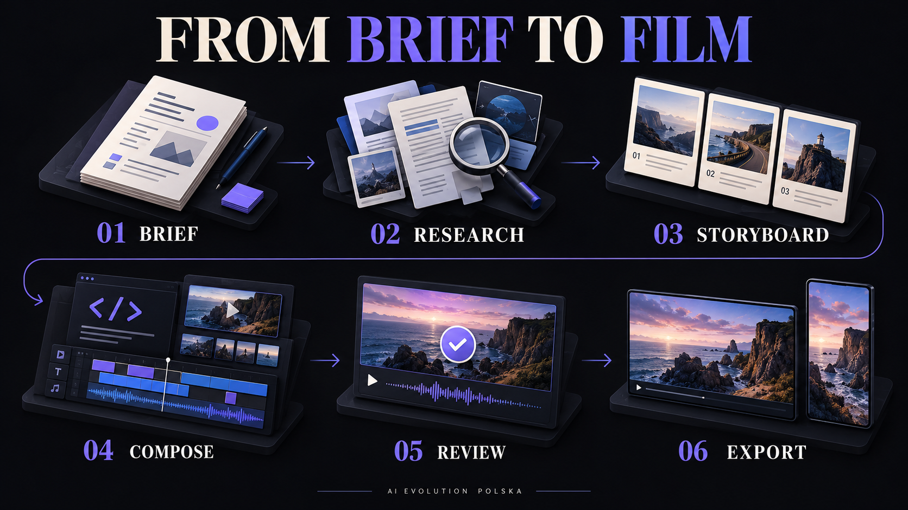
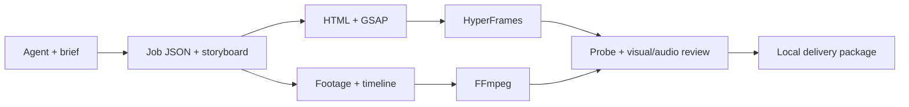

[](https://github.com/aievolutionpl/social-motion-agent/raw/refs/heads/main/docs/media/premium-intro.mp4)

<h1 align="center">Social Motion Agent</h1>
<p align="center"><strong>Od pomysłu do filmu. Z agentem AI, HyperFrames i kontrolą jakości.</strong></p>
<p align="center">Produkt <a href="https://www.aievolutionpolska.pl/">AI EVOLUTION POLSKA</a> · Open source · Local first</p>
<p align="center"><a href="https://github.com/aievolutionpl/social-motion-agent/actions/workflows/ci.yml"></a> <a href="LICENSE"></a> <a href="docs/README.en.md">English</a> · <a href="START_HERE.md">Start agenta</a> · <a href="docs/PRODUCTION.md">Produkcja</a></p>

**Twórz explainery, premiery produktów, Reels i filmy edukacyjne jako edytowalne projekty.** Agent pomaga przejść od briefu i researchu do scen, materiałów, renderu i sprawdzonego pakietu.

Social Motion Agent to narzędzie CLI i zestaw instrukcji dla agentów, a nie autonomiczny generator „jednym kliknięciem”. Działa z agentami potrafiącymi czytać pliki i wykonywać polecenia, np. Codex, Claude Code lub Cursor. Model AI wybierasz w swoim środowisku.

## Zobacz, co dostaje Twój agent

**[▶ Odtwórz / pobierz film · 30 sekund · 16:9 · polski lektor i napisy](https://github.com/aievolutionpl/social-motion-agent/raw/refs/heads/main/docs/media/premium-intro.mp4)** · [Wszystkie edytowalne źródła](examples/premium-intro/README.md)

Generowana filmowa scenografia, dynamiczna typografia, autentyczne widoki skilli w Codexie, polska narracja i muzyka. Ten film jest zbudowany z lokalnego HTML/GSAP. Wszystkie wykorzystane materiały są w repozytorium, więc możesz odtworzyć go bez płatnych API:

```bash
npm ci
python -S scripts/premium_intro.py --render
```

Wynik: `output/jobs/<id>/renders/premium-intro.mp4`, **1920 × 1080, 30 FPS, 30 sekund, stereo**. Skrypt tworzy nową produkcję i wykonuje kontrolę techniczną. Pierwszy render może pobrać Chromium. Zrzuty Codexa są prawdziwe, a ich najazdy animowane; film nie jest nagraniem całego wykonania zadania przez agenta.

Starszy przykład 36-sekundowy w pionie, z produktem, geometrycznym 3D i pixel artem, pozostaje dostępny: [showcase](examples/showcase/README.md), `python -S scripts/showcase.py --render`.

## Co ten warsztat daje Codexowi?

Otwierasz przygotowane repozytorium w Codexie i opisujesz film. Agent otrzymuje instrukcje prowadzenia produkcji, bibliotekę efektów, szablony kompozycji, narzędzia renderowania i sprawdzania wyniku. Skille pomagają dobrać proces do zadania, a pliki projektu pozwalają wrócić do konkretnej sceny i poprawić ją bez zaczynania od zera.

| Chcesz zrobić | Co jest w środku |
| --- | --- |
| Intro YouTube, reklamę produktu, explainer, rolkę | Brief w pięciu pytaniach, research, scenariusz i storyboard |
| Animowane tytuły, napisy, plansze i dane | HyperFrames + GSAP, tokeny wyglądu, motion design i edytowalny HTML |
| Montaż własnych ujęć z głosem i muzyką | FFmpeg, oś czasu, kadrowanie, miks, ducking i biblioteka dźwięków |
| Pokaz aplikacji lub tutorial | Skill screen-tutorials i integracja OpenScreen; runtime instalujesz osobno |
| Różne style: cinematic, kinetic type, retro, przestrzenne kompozycje | Katalog ruchu, przykłady i źródła skilli 3D/WebGL/Manim; ich dodatkowe środowiska nie uruchamiają się automatycznie |
| Materiały AI dopasowane do sceny | Workflow imagegen, opcjonalny ElevenLabs i fal H3 Max; nowe generacje wymagają własnego dostępu do usług |
| Materiał, który można poprawiać i przekazać dalej | Osobna karta produkcji, źródła, assety, napisy, SHA i HANDOFF.md |

**Siedem lokalnych punktów wejścia:** `social-motion-studio` prowadzi produkcję, `intake` zbiera brief, `production` pilnuje procesu, `motion-design` określa zasady animacji, `motion-effect-picker` dobiera ruch, `motion-ui-polish` sprawdza ramki, a `screen-tutorials` pomaga przy pokazach ekranu. [Pełny indeks i ścieżki](skills/INDEX.md).

Katalog źródeł to biblioteka instrukcji, recipes i szablonów. Nie oznacza setek aktywnych połączeń API ani automatycznie zainstalowanych silników. Render dołączonego intro działa lokalnie; tworzenie nowych obrazów i głosu zależy od usług dostępnych w Twoim środowisku.

## Krótkie demo techniczne


*8-sekundowa, niema kompozycja HTML z repozytorium. GIF pokazuje rzeczywisty render; okładka i grafika procesu są ilustracjami koncepcyjnymi wygenerowanymi przez AI.*

## Pobierz bibliotekę w jednej paczce

**[Pobierz pełny ZIP — skille, 34 narzędzia i wszystkie assety](https://github.com/aievolutionpl/social-motion-agent/releases/download/v1.1.0/social-motion-agent-v1.1.0-full.zip)**

Wydanie **v1.1.0** zawiera nowe intro 30 s, jego pełne źródła, wcześniejsze przykłady oraz wszystkie 34 przypięte repozytoria biblioteki. Gotowy film jest w `docs/media/premium-intro.mp4`, a materiały do edycji w `examples/premium-intro/`.

Rozpakuj paczkę i otwórz folder `social-motion-agent`. Pełne źródła są już w środku: bez Git, submodułów i instalatora biblioteki. Integralność sprawdzisz poleceniem `python -S scripts/verify_bundle.py`. Do renderowania potrzebujesz opisanych niżej środowisk i `npm ci`; paczka nie zawiera binariów środowisk, cache ani zewnętrznych plików Git LFS, których nie było w oryginalnej kolekcji. Licencje narzędzi i zasady użycia mediów pozostają bez zmian.

## Kompletny warsztat w repozytorium

Dołączamy **126 oryginalnych efektów dźwiękowych**, **9 teł WebP**, **4 rodziny fontów z licencjami OFL**, **7 lokalnych skilli** oraz katalog **913 wpisów z 34 repozytoriów narzędziowych**. Katalog obejmuje również recipes, szablony i fixture testowe.

Media są bezpośrednio w `SOUND EFFECTS/` i `assets/`. Pełne źródła narzędzi znajdują się w `tools/repos/` jako submoduły Git, z przypiętymi wersjami i oryginalnymi licencjami.

```bash
# Pełna instalacja źródeł i materiałów
git clone --recurse-submodules https://github.com/aievolutionpl/social-motion-agent.git
cd social-motion-agent
npm ci
python -S scripts/bootstrap_library.py --check
python -S scripts/library_check.py
```

**Pobrałeś automatyczny GitHub „Source code (zip)” lub masz już zwykły klon?** Uruchom `python -S scripts/bootstrap_library.py`. Automatyczny GitHub ZIP (inny niż pełna paczka powyżej) zawiera media, ale nie zawartość submodułów; instalator uzupełni wszystkie źródła. Nie instaluje automatycznie zależności 34 narzędzi ani nie uruchamia ich kodu.

[Zawartość i pobieranie biblioteki](docs/LIBRARY.md) · [Katalog skilli](skills/INDEX.md) · [Narzędzia](tools/INDEX.md) · [Prawa do mediów](docs/MEDIA_RIGHTS.md)

## Pierwszy film

Wymagania: **Python 3.11+**, **Node.js 22+**, **FFmpeg i ffprobe** dostępne w PATH. Pythonowy rdzeń nie wymaga pakietów pip.

```bash
git clone https://github.com/aievolutionpl/social-motion-agent.git
cd social-motion-agent
npm ci
python -S studio.py doctor
python -S studio.py demo --render
```

Komenda zwraca katalog produkcji, ścieżkę MP4 i wynik kontroli technicznej. Pierwszy render może pobrać Chrome. Render demo nie wymaga kluczy API ani płatnej generacji.

```bash
# Wersja pionowa: 1080 × 1920
python -S studio.py demo --format 9:16 --render

# Podgląd edytowalnego przykładu w HyperFrames Studio
npm run preview
```

Pliki powstają w `output/jobs/<id>/`. Kolejne uruchomienie demo tworzy nową produkcję.

## Co dostajesz

| Potrzeba | Rozwiązanie |
| --- | --- |
| Piękny motion zamiast przypadkowych przejść | HyperFrames, lokalny GSAP, szablony typografii i instrukcje motion design |
| Agent rozumiejący etap pracy | Brief, research, storyboard, rejestr assetów i `resume` |
| Montaż własnych materiałów | FFmpeg: ujęcia, kadrowanie, lektor, muzyka, ducking i efekty |
| Wersje na różne kanały | Profile 16:9, 9:16, 4:5, 1:1; kompozycję należy sprawdzić w każdym formacie |
| Kontrola przed oddaniem filmu | Wymiary, FPS, długość, wymagane audio, SHA plików i dowody recenzji |
| Praca bez klientowskiego chaosu | Osobny katalog każdej produkcji, edytowalne źródła i HANDOFF.md |
| Własny głos i obrazy | Opcjonalny adapter ElevenLabs; obrazy i przebitki importowane z Twoich narzędzi |

## Jak działa



1. **Brief**: cel, widz, styl, audio i ograniczenia. Zapisujesz faktyczne odpowiedzi.
2. **Research**: źródła faktów, referencje wizualne i prawa do materiałów.
3. **Storyboard**: sceny, czas, tekst i rola każdego assetu.
4. **Compose**: agent pisze HTML/GSAP albo układa materiały na osi FFmpeg.
5. **Review**: oglądasz klatki, czytasz napisy, słuchasz miksu. Wynik jest przypisany do konkretnego pliku.
6. **Export**: pakiet zawiera master, źródła, rejestr materiałów i dowody kontroli.

Zmiana kompozycji unieważnia poprzednią kontrolę techniczną. Niezaakceptowany film nie przejdzie przez `pack`. Narzędzie sprawdza kompletność dowodów, ale nie zastępuje ludzkiego osądu jakości i praw do mediów.

## Daj zadanie agentowi

Otwórz repozytorium w swoim narzędziu AI i użyj:

> Przeczytaj AGENTS.md i START_HERE.md. Przygotuj 20-sekundowy explainer mojego produktu w formacie 9:16. Zacznij od briefu, zaproponuj kierunek wizualny, wykonaj research i storyboard. Użyj HyperFrames. Najpierw pokaż draft. Nie uruchamiaj płatnych usług ani nie publikuj bez mojej zgody.

```bash
python -S studio.py new "My product" --kind explainer --format 9:16 --duration 20
python -S studio.py route explainer
python -S studio.py resume output/jobs/JOB_ID
python -S studio.py check output/jobs/JOB_ID --stage assets
python -S studio.py render-html output/jobs/JOB_ID --name draft
python -S studio.py sheet output/jobs/JOB_ID --render renders/draft.mp4
```

`JOB_ID` zastąp nazwą zwróconego katalogu. Przed renderem uzupełnij plan i utwórz `source/index.html`. Szczegółowe kroki: [produkcja](docs/PRODUCTION.md), [HyperFrames](docs/HYPERFRAMES.md), [CLI](docs/CLI.md).

## Architektura



- `studio.py`: jeden punkt wejścia.
- `scripts/studio_core.py`: stan produkcji, pochodzenie materiałów, kontrola i pakiet.
- `scripts/hyperframes_adapter.py`: lokalny lint, render, log i probe.
- `skills/`: lokalne instrukcje do briefu, produkcji i projektowania ruchu.
- `examples/premium-intro/`: główna pokazówka 30 s, komplet materiałów i instrukcja odtworzenia.
- `examples/launch/` i `examples/showcase/`: wcześniejsze przykłady techniczne i stylistyczne.
- `templates/`: tokeny wizualne i pomocnicze szablony.
- `sources.lock.json` i `.gitmodules`: dokładne wersje pełnych źródeł narzędziowych.

## Prywatność i integracje

Repozytorium zawiera kod, neutralne przykłady i publiczne oznaczenie autora produktu. Nie zawiera materiałów klientów, historii kampanii, modeli głosu, identyfikatorów kont ani połączeń kont. Pokazówka zawiera zatwierdzoną przez właściciela gotową narrację audio; nie zawiera modelu ani danych dostępu do jego głosu.

Sekrety ustawiasz we własnym środowisku. `doctor` nie czyta kluczy i nie testuje kont w sieci. Dane produkcji pozostają w ignorowanym przez Git katalogu `output/`. Polecenia rdzenia nie publikują filmów.

[Providerzy i koszty](docs/PROVIDERS.md) · [Bezpieczeństwo](SECURITY.md) · [Licencje zależności](THIRD_PARTY_NOTICES.md)

## Testy i granice

```bash
python -S -B -m unittest discover -s tests -v
python -S scripts/smoke_test.py
python -S scripts/release_check.py
```

CI uruchamia testy na Pythonie 3.11 i 3.13, test montażu FFmpeg oraz rzeczywisty render HyperFrames. Testy skatalogowanych bibliotek uruchamiają się po pobraniu źródeł. Testy Playwright są pomijane, gdy przeglądarka pomiarowa nie jest zainstalowana.

- Demo i podstawowy montaż działają bez płatnych API.
- Płatne generowanie głosu wymaga Twojego konta i jawnego `--execute`.
- Źródła OpenScreen i katalogu ruchu są dołączone przez submoduły; runtime OpenScreen i dodatkowy adapter video-studio wymagają osobnej instalacji.
- Podgląd HyperFrames jest lokalnym edytorem; repo nie zawiera osobnej aplikacji SaaS.
- Spójność renderu między systemami zależy m.in. od fontów i przeglądarki; dla ściśle powtarzalnego środowiska użyj oficjalnej ścieżki Docker HyperFrames.

[Wyniki weryfikacji](docs/VALIDATION.md) · [Jak współtworzyć](CONTRIBUTING.md)

## AI EVOLUTION POLSKA

Budujemy praktyczne narzędzia do pracy z AI. Social Motion Agent łączy proces twórczy z kodem, który można sprawdzić, zmienić i uruchomić lokalnie.

[Strona AI EVOLUTION POLSKA](https://www.aievolutionpolska.pl/) · [GitHub](https://github.com/aievolutionpl)

Kod: [MIT](LICENSE). Zależności mają własne licencje. Projekt jest niezależny od HeyGen i nie sugeruje jego poparcia.
