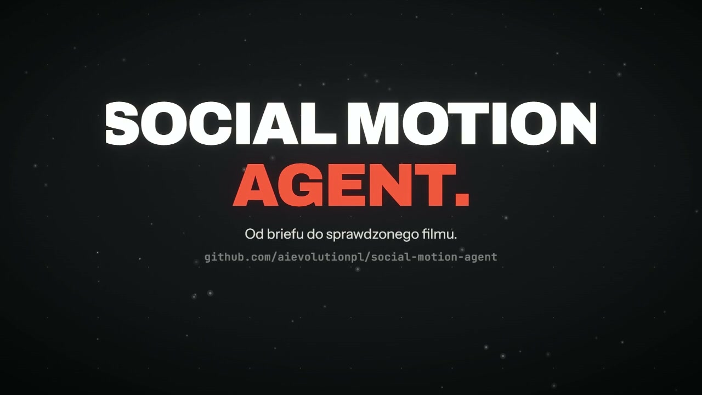

# Social Motion Agent

[](https://github.com/aievolutionpl/social-motion-agent/raw/refs/heads/main/docs/media/kinetic-launch.mp4)

**[Watch the 30-second Kinetic Film demo](https://github.com/aievolutionpl/social-motion-agent/raw/refs/heads/main/docs/media/kinetic-launch.mp4)** · [Editable source](../examples/kinetic-launch/README.md)

The permanent `kinetic-launch` route creates typography-led launch films with Scenario's separately obtained,
hash-verified Kinetic Film engine. Beat-timed scenes, CSS 3D camera motion and temporal motion blur stay inside
the existing brief → research → storyboard → render → review workflow. Style Atlas, Unslop and the other renderers
remain available. See [setup and production commands](KINETIC_FILM.md).

**From brief to a crafted video, website or animated product interface.** An open-source workshop by AI EVOLUTION POLSKA for coding agents with file and tool access.

Start with [Creative Director](../skills/creative-director/SKILL.md), the portable compound skill. Its 10 reference modules cover brief/art direction, video direction, websites, UI motion, visual recipes, anti-slop, a Polish/English humanizer, engines, review and source provenance. It reuses known answers and asks only missing material questions. Directions describe real section/shot placements before a substantial build.

## Three modes

- **video:** storyboard, local composition, audio/captions, render evidence and delivery.
- **website:** conversion strategy, distinctive composition, existing stack and browser review.
- **ui-motion:** faithful static UI first, then meaningful interaction or film export according to the brief.

A website with subtle motion does not automatically require a video. A product video does not authorize redesigning the product. Brand choices and factual accuracy override upstream aesthetic defaults.

## Prepare selected sources

```bash
git clone https://github.com/aievolutionpl/social-motion-agent.git
cd social-motion-agent
python -S studio.py skills plan --mode video
python -S studio.py skills setup --mode video
python -S studio.py skills check --mode video
```

Modes: `video`, `website`, `ui-motion`. Video selects Hypermotion + Elaya AI Design Skills. Website selects Elaya + Taste Skill v2. UI motion selects all three. Setup fetches pinned sources without running upstream code. Check verifies source integrity offline, including full manifest bundles; it never certifies a renderer or account.

The extended catalogue contains 924 entries (916 upstream + 8 local) from 36 upstream repositories. Entries include recipes/templates/test fixtures, not 924 working integrations. Read only relevant files. Use `scripts/bootstrap_library.py` for the optional full collection.

## Install and render

```bash
python -S scripts/install_skill.py --agent codex
python -S scripts/install_skill.py --agent codex --execute
# Alternatives: --agent claude, --agent hermes, or --dest CUSTOM_SKILL_PARENT
```

The package is self-contained and existing modified installations are preserved. [Agent setup](AGENT_SETUP.md) explains profile paths and the distinction between a readable GitHub repository and an execution environment.

For local video rendering install Python 3.11+, Node 22+, FFmpeg and ffprobe, then:

```bash
python -S studio.py setup
python -S studio.py demo --format 9:16 --render
python -S scripts/premium_intro.py --render
```

Setup uses locked Node dependencies. The first render may need Chromium. Supplied examples do not make paid generation requests. The current [Kinetic Film source](../examples/kinetic-launch/README.md) contains Polish typography, a supplied music/SFX mix and a beat-timed composition; it is a workflow illustration, not a recording of agent execution.

HyperFrames/GSAP is the default HTML renderer. Hypermotion is a separate desktop/CLI/MCP product with native `.hype` scenes; downloading its skills does not install the app. Verify its platform/runtime and a small export before production. Do not silently substitute an explicitly requested engine. [Hypermotion setup](HYPERMOTION.md).

## Verification and limits

Render receipts bind a generated MP4 to its source fingerprint. Source edits require re-rendering; probing an old file cannot reapprove it. Video stream duration is checked independently of container/audio duration. Packaging still requires actual visual/audio review evidence.

```bash
python -S -B -m unittest discover -s tests -v
python -S scripts/smoke_test.py
python -S scripts/release_check.py
```

The [archived v1.1.1 full ZIP](https://github.com/aievolutionpl/social-motion-agent/releases/download/v1.1.1/social-motion-agent-v1.1.1-full.zip) has 34 source trees and predates this compound skill and fixes. Use the current checkout for the new workflow; no newer full release is claimed here.

[Production](PRODUCTION.md) · [CLI](CLI.md) · [Media rights](MEDIA_RIGHTS.md) · [Third-party notices](../THIRD_PARTY_NOTICES.md) · [Validation](VALIDATION.md)

Code is MIT. Media and third-party tools retain separate terms. The SFX library has owner redistribution authorization; supporting license evidence is still pending. No private client assets, account credentials or production history are supplied. Local production is not authorization to publish or buy generations.
