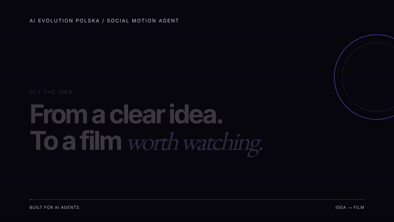

# Social Motion Agent

**An AI-assisted video production toolkit by AI EVOLUTION POLSKA.**

Turn a brief into an editable film with agent instructions, HyperFrames/GSAP compositions, FFmpeg assembly, provenance records and review gates. This is a CLI workflow for coding agents, not a hosted SaaS or an autonomous one-click generator.


## Download the complete bundle

**[Download full ZIP: all skills, 34 tool sources and assets](https://github.com/aievolutionpl/social-motion-agent/releases/download/v1.0.0/social-motion-agent-v1.0.0-full.zip)**

Extract and open `social-motion-agent`. No Git, submodule checkout or library bootstrap is needed. Verify with `python -S scripts/verify_bundle.py`. Rendering still requires the runtimes below and `npm ci`. Runtime binaries, caches and unavailable upstream Git LFS payloads are not bundled. Original licenses and media rights apply. This is separate from GitHub’s automatic Source code ZIP.

## Complete workshop

The repository includes 126 original sound effects, 9 WebP backgrounds, 3 fonts with OFL texts, 7 local skills and a catalogue of 913 upstream entries. All 34 upstream repositories are pinned Git submodules.

Clone with `git clone --recurse-submodules https://github.com/aievolutionpl/social-motion-agent.git`. Existing clones and ZIP users can run `python -S scripts/bootstrap_library.py` to restore every pinned source. Media is stored directly in this repository. GitHub ZIPs omit submodule contents; bootstrap restores them.

[Full library](LIBRARY.md) · [Media rights](MEDIA_RIGHTS.md). Audio inclusion follows the owner's explicit redistribution authorization; supporting documents are pending and the code license does not relicense audio.

## Quickstart

Requires Python 3.11+, Node.js 22+, FFmpeg and ffprobe in PATH.

```bash
git clone https://github.com/aievolutionpl/social-motion-agent.git
cd social-motion-agent
npm ci
python -S studio.py doctor
python -S studio.py demo --render
```

The demo is an 8-second silent HTML film. No paid AI API calls are needed. The first render may download Chrome.
Use --format 9:16 for portrait. Run npm run preview to open the editable example.



## Workflow

Brief → research → storyboard → compose → review → export.

Open the repository in Codex, Claude Code or another file/terminal-capable agent. Ask it to read AGENTS.md and START_HERE.md before creating your film. The agent can create a job, write HTML scenes, render, inspect and record evidence.

The core tracks SHA-256 hashes and blocks delivery without the required records. A source change invalidates technical evidence. Human judgment is still required for aesthetics, audio, facts and licensing.

[Production guide](PRODUCTION.md) · [HyperFrames](HYPERFRAMES.md) · [CLI](CLI.md) · [Providers](PROVIDERS.md) · [Validation](VALIDATION.md)

## Privacy and licensing

No client assets, personal voice IDs, account connections or production histories are bundled. Production stays in ignored output folders. Secrets come from your own environment. Publishing and paid generation require explicit authorization.

Original code: MIT. Dependencies retain their own licenses. An independent product of [AI EVOLUTION POLSKA](https://www.aievolutionpolska.pl/), not affiliated with HeyGen.
